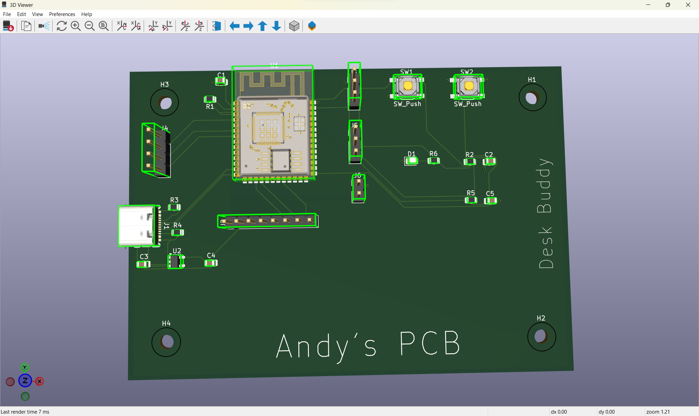

 # Projet Fallen
 My project is named, Deskbuddy because I wanted to do a desk companion. I am a begginer.
 So I used AI but not to do my job, my principal objective is to learn electronics and have fun
 My project is using an ESP32-S3-WROOM-1-N16R8, 2 buttons for reset and boot, a led to have a diagnostic etc... (to see every component exactly, look in the BOM)
 To see the schematics and PCB screenshots, look in the Sreenshots.
 
 